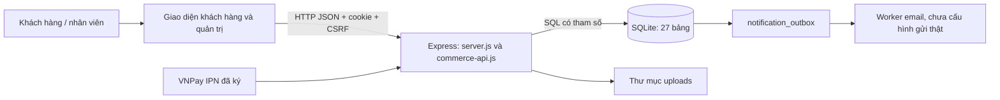

# Kiến trúc, tương tác và quy tắc triển khai

## Hệ thống hiện tại



Frontend không có thông tin kết nối DB. `server.js` xử lý bảo mật, tài khoản và admin sản phẩm; `commerce-api.js` xử lý hầu hết nghiệp vụ; `store.js` và `commerce-store.js` tạo schema và hỗ trợ dữ liệu. Có cấu trúc module bước đầu nhưng route, validation, nghiệp vụ và SQL còn trộn nhiều trong cùng hàm, nhiều dòng quá dài; tăng tính năng sẽ khó kiểm tra transaction và quyền.

## Cấu trúc đích: một backend có module theo nghiệp vụ

Giữ một ứng dụng triển khai, tách module rõ trách nhiệm. Chưa cần microservice, Redis hoặc framework frontend mới để sửa cấu trúc.

```text
src/
  app.js                        # lắp middleware/router; không có SQL nghiệp vụ
  server.js                     # mở cổng, shutdown và tác vụ định kỳ
  config/                       # đọc/kiểm tra biến môi trường; không giữ khóa trong Git
  db/
    connection.js               # pool, transaction, timeout, TLS
    migrations/                 # migration version hóa; không tự reset DB
  middleware/                   # session, Origin/CSRF, permission, validation, lỗi
  modules/
    identity/                   # tài khoản, nhân viên, MFA, session, quyền
    catalog/                    # danh mục, thương hiệu, sản phẩm, SKU, media
    inventory/                  # kho, balance, reservation, movements
    checkout/                   # quote, idempotency, tạo đơn
    orders/                     # state machine, quyền chủ đơn, lịch sử
    payments/                   # intent, callback, ledger, refund
    shipping/                   # carrier adapter, shipment, webhook
    customers/                  # hồ sơ, địa chỉ, consent, CRM
    support/                    # ticket, return, bảo hành khi triển khai
    content/                    # menu, banner, bài viết, chính sách
    reporting/                  # query báo cáo theo quyền, không sửa ledger
    integrations/               # BigSeller và đối tác theo hợp đồng adapter
  workers/                      # outbox, hết hạn reservation, đồng bộ, bảo trì
public/
  pages/                        # giao diện theo nhóm nghiệp vụ
  api/                          # client HTTP dùng chung
test/
  unit/                         # state machine/quy tắc giá độc lập
  integration/                  # API + DB thật + quyền + rollback
  browser/                      # luồng người dùng
```

Trong mỗi module: `routes → controller → service → repository`. Controller chuyển HTTP thành đầu vào đã kiểm tra; service quyết định quyền nghiệp vụ và transaction; repository chỉ truy vấn, nhận cùng transaction client. Không cho repository tự mở transaction mới bên trong transaction checkout. Không trả nguyên bản ghi tài khoản/đơn cho frontend; dùng DTO/public projection có danh sách trường rõ ràng.

Các bước trên là cấu trúc đề xuất, chưa đổi tên/chuyển file hiện tại. Chuyển từng module và giữ hợp đồng API/test làm hàng rào hồi quy, tránh viết lại toàn bộ cùng lúc.

## Ví dụ luồng đặt hàng

```mermaid
sequenceDiagram
  actor C as Khách hàng
  participant UI as Giao diện
  participant API as Checkout API
  participant S as Checkout service
  participant DB as PostgreSQL
  participant W as Outbox worker
  C->>UI: Chọn SKU, số lượng, địa chỉ, thanh toán
  UI->>API: POST quote (ID, số lượng, mã giảm giá)
  API->>S: Xác thực đầu vào và phiên
  S->>DB: Đọc giá, tồn, quy tắc, quyền dùng ưu đãi
  S-->>UI: Tổng tiền và phí do máy chủ tính
  C->>UI: Kiểm tra và xác nhận
  UI->>API: POST orders + Idempotency-Key
  API->>S: Kiểm tra Origin/CSRF và chủ thể
  S->>DB: BEGIN; khóa key, coupon, tồn theo thứ tự cố định
  S->>DB: Tính lại giá; giữ tồn bằng UPDATE có điều kiện
  S->>DB: Ghi order, line snapshots, history, audit, outbox, kết quả key
  S->>DB: COMMIT
  S-->>UI: Mã đơn; cùng key trả kết quả cũ
  W->>DB: Nhận outbox với lease
  W-->>C: Gửi xác nhận sau commit khi cấu hình dịch vụ
```

Không giữ transaction DB trong lúc chờ khách thanh toán hoặc gọi API bên ngoài. Một transaction chỉ kéo dài phần đọc/ghi nghiệp vụ cần nguyên tử.

### UC-055/060 — xác nhận đặt hàng

- Actor: guest/customer; đầu vào là SKU, số lượng, địa chỉ, phương thức, coupon/points, key. Giá client chỉ để hiển thị, không được dùng làm giá chuẩn.
- Điều kiện: SKU còn bán, địa chỉ Việt Nam hợp lệ, không quá giới hạn, đủ tồn/điểm/coupon. Dùng khóa idempotency chuẩn hóa theo account hoặc guest capability; không nhận customer ID tùy ý từ request.
- Backend bắt buộc key; fingerprint cùng nội dung trả cùng đơn, khác nội dung trả 409. Key, giữ tồn, order/items và outbox commit cùng nhau. Mất response sau commit vẫn retry an toàn.
- Dữ liệu đích: `idempotency_keys`, `orders`, `order_items`, `inventory_balances`, `inventory_reservations`, `stock_movements`, `coupon_redemptions`, `loyalty_ledger`, `order_status_history`, `outbox_events`, `audit_logs`.
- Nghiệm thu: sửa giá ở client không đổi giá thật; hai checkout tranh đơn vị cuối chỉ một thành công; lỗi giữa transaction không tạo đơn/trừ tồn; gửi lại không trừ tồn hai lần. Gửi key trong cùng account không được trả guest token của người khác.

### UC-052/056/168 — thanh toán

- Khách yêu cầu payment link cho đơn mình; backend tạo intent, gọi adapter ngoài transaction nếu cần. Trang return hiển thị trạng thái, không ghi đã thu.
- Callback xác minh chữ ký bằng body/query đúng đặc tả, merchant, reference, số tiền, currency, loại sự kiện. Chống trùng theo provider/external ID và fingerprint; cùng ID khác payload là bất thường.
- Transaction khóa order bằng `SELECT ... FOR UPDATE`, kiểm tra trạng thái hiện tại, ghi event + ledger + lịch sử + outbox và cập nhật trạng thái suy ra từ ledger.
- Callback muộn cho đơn hết hạn: `requires_reconciliation`, không tự giao hoặc tự lấy tồn đã nhả. Có tác vụ đối soát/khôi phục nếu nhà cung cấp đã thu nhưng local commit lỗi.
- Nghiệm thu: callback lặp chỉ một receipt; chữ ký/số tiền sai không đổi đơn; hai callback không ghi nhận vượt tổng; client gửi `paid=true` không có tác dụng.

### UC-120/129 — điều chỉnh kho

- Nhân viên có `inventory.adjust`, scope kho cụ thể nếu đã triển khai. Nhập delta, lý do, chứng từ; vượt hạn mức yêu cầu người phê duyệt khác.
- Khóa balance theo kho/SKU; cập nhật có điều kiện không âm, ghi movement và audit trong cùng transaction. Không lấy tồn từ báo cáo giao diện để ghi đè.
- Nghiệm thu: không điều chỉnh vượt tồn, không làm on_hand thấp hơn reserved, log có người/lý do/before-after; lỗi log rollback tồn.

### UC-066/071/172 — hủy, trả và hoàn tiền

- Chủ đơn chỉ yêu cầu hủy/trả theo state machine; nhân viên có quyền riêng quyết định. Khóa order trước, chỉ nhả reservation ở trạng thái held; không hoàn tồn/điểm hai lần.
- Mỗi return theo từng order item/quantity; tổng trả không vượt lượng đã giao. Hàng hư không nhập kho bán lại.
- Refund yêu cầu quyền và hạn mức; tổng hoàn không vượt đã thu. Gọi provider với idempotency key ngoài transaction; chờ xác nhận provider rồi ghi ledger, xử lý reconciliation nếu response mất.
- Nghiệm thu: không hủy trực tiếp đơn đang giao/đã thu chưa hoàn; không dùng quyền sales để hoàn tiền; retry không chuyển tiền hai lần. Không diễn giải việc có bảng `refunds` là đã kết nối hoàn tiền thật.

### UC-197/198/209 — quyền nhân viên

- Customer là quan hệ account–customer, không cần cấp vai trò nhân viên. Dùng chung identity đã đủ; tách quyền customer/staff tại API, không bắt buộc hai bảng đăng nhập/hai bộ mật khẩu.
- Owner cấp quyền, khóa tài khoản, thu hồi phiên. Không nhận role từ đăng ký; không cho staff tự nâng quyền. Kiểm tra quyền hành động và đối tượng/kho ở server cho mọi request.
- Sales xử lý đơn; accounting ghi tiền/phê duyệt hoàn theo chính sách; inventory điều chỉnh kho; marketing sửa nội dung. Xuất khách hàng là quyền riêng.
- Thay ngân hàng/cấp quyền/hoàn lớn cần xác thực lại và audit. Quyền trong schema là khung khởi tạo, cần thống nhất ma trận vận hành và kiểm tra UI/API.

### UC-219/228 — đồng bộ BigSeller

- Xác nhận quyền API và nguồn tồn chính. Nếu không giữ tồn xuyên kênh tức thời, cấp quota riêng cho website cộng mức dự phòng.
- Mapping SKU/kênh, external order ID duy nhất; inbox dedupe và outbox retry, watermark/cursor đồng bộ, phiên bản sự kiện để chống cập nhật cũ đè mới. Không thể giải quyết bán vượt đa kênh bằng một CHECK local.
- Nghiệm thu: webhook trùng/đảo thứ tự, API timeout, mapping sai, lệch tồn, replay và đối soát. Chưa triển khai khi chưa có API/hợp đồng của đối tác.

## Trạng thái và transaction cần thống nhất

| Đối tượng | Luồng chuẩn | Lưu ý |
| --- | --- | --- |
| Đơn | pending → confirmed → shipped → completed; hủy theo điều kiện | `CHECK` chỉ giới hạn giá trị; service phải kiểm tra chuyển trạng thái và quyền |
| Tiền | unpaid/partial/paid/partially_refunded/refunded | Suy ra từ receipt/refund đã xác minh, tách khỏi trạng thái đơn |
| Giữ tồn | held → consumed hoặc released | Checkout tăng reserved; xuất hàng giảm cả on_hand và reserved; hủy chỉ giảm reserved |
| Trả | requested → approved/rejected → received → closed | Có kiểm số lượng, chất lượng, tổng hoàn và chứng từ |
| Outbox | queued → processing → sent; retry/failed | Lease hết hạn có thể nhận lại; bên ngoài phải idempotent vì có thể giao ít nhất một lần |

Transaction dùng READ COMMITTED với khóa hàng rõ ràng; khóa order trước ghi thu/hoàn, khóa balances theo thứ tự `(warehouse_id,variant_id)`; khóa coupon trước đếm lượt. Retry có giới hạn khi deadlock/serialization conflict. Nếu chọn REPEATABLE READ/SERIALIZABLE, phải xử lý SQLSTATE 40001; không retry mù API chuyển tiền.

## Thứ tự triển khai để giữ cấu trúc

1. Sửa tính nguyên tử audit, bắt buộc idempotency, quyền hoàn tiền và chính sách staff/MFA trên SQLite; thêm test lỗi giữa transaction/quyền/retry.
2. Tách checkout, inventory, payments thành service/repository; giữ UI và hợp đồng API, không đổi DB cùng lúc.
3. Viết adapter PostgreSQL và migration data trên bản sao; chuyển sync SQLite API sang `pg` async. Dùng tiền VND số nguyên, xử lý bigint ở biên JSON rõ ràng.
4. Đối soát counts/tiền/tồn/quyền, kiểm restore và chuyển staging; sau đó mới cutover có cửa sổ dừng ghi và rollback.
5. Bổ sung CSKH, vận chuyển, hóa đơn/đa kênh theo thứ tự nhu cầu; mỗi use case có actor, dữ liệu vào/ra, quyền và tiêu chí nghiệm thu trước khi code.
