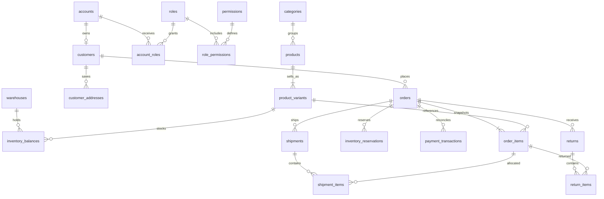

# Cơ sở dữ liệu cho Super Net

## Lựa chọn đề nghị

**PostgreSQL là hệ quản trị đích phù hợp** cho yêu cầu nhiều nhân viên, nhiều kho, đối soát tiền và tích hợp đa kênh. PostgreSQL là phần mềm nguồn mở, không thu phí bản quyền sử dụng. Chi phí máy chủ, lưu trữ, backup, lưu lượng và quản trị vẫn cần tính riêng.

Nếu ưu tiên giao diện dễ quản lý, dùng PostgreSQL trên **Supabase** và quản lý bằng Table Editor/SQL Editor. **Neon** là lựa chọn PostgreSQL được quản lý khác, phù hợp khi giữ backend/auth Express. Cả hai có mô hình gói miễn phí giới hạn; hạn mức, chính sách ngủ/tạm dừng, backup và điều kiện thương mại có thể thay đổi. Tác vụ này bị HTTP 403 khi đọc các trang giá nên không xác nhận dung lượng hoặc giá hiện hành. Kiểm tra [Supabase Pricing](https://supabase.com/pricing) hoặc [Neon Pricing](https://neon.com/pricing) trước khi chọn gói. Không mặc định gói miễn phí là kế hoạch vận hành lâu dài hoặc có sẵn backup phục hồi theo thời điểm.

| Lựa chọn | Phù hợp | Đánh đổi |
| --- | --- | --- |
| SQLite hiện tại | Một instance, cửa hàng nhỏ, phát triển/test, không cần tài khoản dịch vụ | File DB cần ổ bền vững; một writer tại một thời điểm; vận hành nhiều instance/phân tích lớn khó hơn |
| PostgreSQL tự quản | Cần toàn quyền, SQL/FK/transaction/khóa hàng và nhiều kết nối | Cần quản trị server, backup, cập nhật, giám sát |
| Supabase PostgreSQL | Muốn quản lý DB bằng web và bắt đầu thuận tiện | Quota/gói dịch vụ; cần thiết lập backend role và kết nối/pool đúng; Auth/Storage là lựa chọn riêng |
| Neon PostgreSQL | Backend riêng, muốn DB được quản lý và môi trường theo nhánh | Quota/kết nối/cold start tùy gói; vẫn cần lưu ảnh ở object storage phù hợp |
| MySQL/MariaDB | Đội đã quen hệ sinh thái này | Cũng phù hợp SQL, nhưng không có lợi ích rõ để đổi lựa chọn đích khỏi PostgreSQL ở dự án này |

Không cần mua dịch vụ để thử schema: `verify.sh` dùng image PostgreSQL chính thức trong Docker. pgAdmin hoặc DBeaver Community là công cụ quản trị miễn phí khi tự vận hành. Không tự tạo tài khoản cloud, dự án Supabase/Neon, hoặc yêu cầu người dùng gửi mật khẩu qua chat.

Giữ auth Express trong giai đoạn chuyển DB để tránh hai nguồn tài khoản. Không cho trình duyệt dùng DATABASE_URL, mật khẩu DB hay service-role key. Frontend gọi API; API mới kết nối PostgreSQL. Redis chưa bắt buộc: outbox và reservation ban đầu có thể chạy bằng PostgreSQL.

## Cơ sở dữ liệu hiện có

`store.js:111` và `commerce-store.js:10` tạo/nâng cấp SQLite. Khởi tạo DB tạm xác nhận 27 bảng; bản cấu trúc không chứa dữ liệu nằm ở [current-schema.sql](../../database/sqlite/current-schema.sql).

| Nhóm | Bảng hiện có | Nhận xét |
| --- | --- | --- |
| Identity | users, sessions, account_tokens, mfa_recovery | Role trong users; TOTP seed trực tiếp trong users |
| Khách hàng | addresses, wishlists | Guest đang là user nội bộ có email giả và mật khẩu ngẫu nhiên |
| Catalog | products, product_variants, demo_catalog_seed | Category/SKU cha/details JSON; SKU biến thể UNIQUE |
| Đơn hàng | orders, checkout_requests, order_events | Line snapshot trong `orders.items` JSON; không có order_items quan hệ |
| Kho | inventory_movements | Tồn trên products/variants; chưa warehouse hoặc reservations |
| Thanh toán | payment_intents, payment_transactions | Reference ledger UNIQUE; kind/status chủ yếu kiểm tra ở API |
| Giao/Trả | shipments, return_requests | Một shipment và tối đa một return cho mỗi order |
| Coupon/Rewards/Review | coupons, loyalty_ledger, reviews | Coupon scope JSON; hạn mức dùng đếm trên orders |
| Nội dung | settings, commerce_settings | JSON, một hàng cấu hình; không phải tự thân là lỗi nếu có validation |
| Vận hành | notification_outbox, audit_log, analytics_events, chat_sessions, chat_messages | Cần chính sách quyền, retention, worker và audit chi tiết |

SQLite đã bật WAL, foreign_keys và busy_timeout; checkout dùng `BEGIN IMMEDIATE`. Không kết luận SQLite “không có transaction” hoặc “không dùng được cho website”. Lý do chọn PostgreSQL là mục tiêu vận hành mở rộng và cấu trúc nghiệp vụ.

## Schema PostgreSQL đã tạo

[001_initial.sql](../../database/postgresql/001_initial.sql) tạo **51 bảng** trong schema riêng `supernet`, PostgreSQL 17+. Số bảng phục vụ mô hình dữ liệu bên dưới, không phải mục tiêu phải đạt số bảng trong tài liệu dán.

| Nhóm | Bảng đích |
| --- | --- |
| Migration | schema_migrations |
| Identity/quyền | accounts, roles, permissions, role_permissions, account_roles, sessions, auth_tokens, mfa_credentials, mfa_recovery_codes |
| Khách hàng | customers, customer_addresses, consent_events |
| Catalog | brands, categories, products, product_variants, product_media |
| Kho | warehouses, inventory_balances, inventory_reservations, stock_movements |
| Checkout/đơn | carts, cart_items, orders, order_items, order_status_history, idempotency_keys |
| Ưu đãi | coupons, coupon_products, coupon_redemptions, loyalty_ledger |
| Thanh toán | payment_intents, payment_events, payment_transactions, refunds |
| Vận chuyển/trả | shipments, shipment_items, returns, return_items |
| Nội dung/đánh giá | wishlist_items, product_reviews, content_pages, banners, store_settings |
| CSKH | support_tickets, ticket_messages |
| Tích hợp/hệ thống | channel_accounts, integration_events, outbox_events, audit_logs |



ERD mô tả cardinality nghiệp vụ mong muốn (sản phẩm có SKU mặc định); một số ràng buộc số lượng hàng con như “mỗi sản phẩm có ít nhất một SKU” còn phải bảo đảm bằng service transaction.

Các quyết định dữ liệu:

- Dùng chung `accounts` cho identity, tách `customers` cho hồ sơ thương mại. Guest có customer không bắt buộc có account, tránh tài khoản/mật khẩu giả. Không gộp guest theo email chưa xác minh.
- Mọi mặt hàng bán có một SKU trong `product_variants`, kể cả sản phẩm không có lựa chọn. Giá/tồn chỉ nằm ở nguồn SKU, loại bỏ mâu thuẫn giá cha/biến thể. SKU duy nhất không phân biệt hoa thường.
- Category/brand có FK; mô tả và thuộc tính linh hoạt dùng JSONB có giới hạn nghiệp vụ. Không biến mọi trường nội dung thành nhiều bảng nếu không cần truy vấn/quan hệ.
- Tiền VND là bigint số nguyên; không dùng float. Backend `pg` thường trả bigint dạng chuỗi: quy định DTO số/chỗi rõ ràng, kiểm Number.isSafeInteger khi chuyển số, không ép tất cả bigint toàn cục.
- `order_items` lưu tên/SKU/giá/chi phí snapshot; FK không làm đơn cũ đổi theo catalog. Giá và tổng đơn đã đặt không sửa trực tiếp. Đổi đơn có ảnh hưởng tiền cần nghiệp vụ adjustment riêng, không lách trigger.
- `on_hand` là hàng bán được vật lý, `reserved` là đã giữ, `available=on_hand-reserved`; on_hand ≥ reserved ≥ 0. Hàng hư không cộng vào on_hand bán được.
- Address snapshot giữ tên/mã tỉnh/xã/version tại lúc đặt; danh mục địa chỉ hiện còn dùng dataset version trong ứng dụng. Backend tiếp tục kiểm cặp tỉnh–xã; các cột text SQL riêng lẻ không thay thế kiểm tra danh mục.
- Một đơn có nhiều shipment/return. FK ghép chặn line của đơn A bị gắn vào kiện/return của đơn B.
- Lịch sử có `visibility=internal/customer`; API chủ động loại ghi chú nội bộ khỏi response cho khách.
- `mfa_credentials` chỉ lưu ciphertext + key version; API phải mã hóa bằng khóa ngoài DB. Password giữ hash; session/reset/recovery giữ hash. SQL không tự thực hiện mã hóa hay xác thực MFA.
- Credential tích hợp chỉ lưu tên binding, không lưu giá trị API key. Outbox/audit phải che dữ liệu nhạy cảm và có retention; không lưu PAN/CVV hoặc thông tin thẻ.

## Điều được SQL bảo vệ và phần backend còn phải làm

| Quy tắc | SQL mới | Backend phải thực hiện |
| --- | --- | --- |
| Giá/tổng hợp lệ | CHECK, subtotal khớp lines bằng deferred constraint trigger; snapshot và tổng tiền bất biến | Đọc giá chuẩn và tính discount/tax/ship; không nhận giá do client quyết định |
| Không bán vượt | Balance CHECK và conditional UPDATE hỗ trợ khóa hàng | Giữ stock/reservation/movement cùng transaction; không chỉ đọc rồi ghi; nguồn tồn đa kênh |
| Không tạo đơn trùng | PK `(scope,principal,key)` | Bắt buộc key, so fingerprint, trả kết quả cũ; an toàn guest token, expiry/retention |
| Không ghi tiền trùng | UNIQUE provider/reference và provider/external ID | Xác minh callback thật; khóa order; retry/reconciliation |
| Không hoàn vượt thu | Trigger cộng receipt/refund dưới order lock | Quyền hoàn, số tiền và trạng thái, quy trình chuyển tiền bên ngoài và xác nhận |
| Dữ liệu đơn lịch sử | Snapshot append-only; FK hạn chế xóa | Workflow hủy/trả/thay đổi được phép và version chính sách |
| Nhật ký | Bảng audit có before/after/request ID; trigger cấm update/delete | Ghi audit cùng mutation, che bí mật, không cấp quyền TRUNCATE/DDL, backup/log ngoài DB |
| Chủ đơn và quyền nhân viên | FK, role/permission seed | Kiểm quyền theo account, object, kho; không tin customer ID từ request; MFA/reauth |

Chưa có procedure checkout/refund hoàn chỉnh; SQL không thay thế service hoặc adapter. Chưa có trigger đồng bộ `sum(reservations)` với `balances.reserved`, ledger với cache `payment_status`, hoặc giới hạn cộng dồn shipment/return/coupon/points. Backend phải khóa các hàng liên quan, cập nhật nguyên tử và có test riêng. `refunds.transaction_id` còn cần kiểm giao dịch thật là loại refund, đúng số tiền và quyền phê duyệt. Category service phải chặn vòng cha–con dài; service kiểm trạng thái/giới hạn tổng lượng. Runtime role không được có quyền tạo trigger, sửa schema, TRUNCATE hoặc bỏ ràng buộc.

Khóa order bằng một câu SELECT FOR UPDATE trước khi ghi thu/hoàn ở READ COMMITTED. Hai phiên ghi tiền đồng thời đã được thử bằng cách này. Tại REPEATABLE READ/SERIALIZABLE phải xử lý serialization failure. Không suy ra việc test concurrency SQL đã kiểm hết concurrency API hoặc nhiều kênh.

## Cách chạy và kết quả

Từ checkout hiện có:

```sh
cd /workspace/Sn-ecom
bash database/postgresql/verify.sh
```

Yêu cầu Docker hoạt động và tải được image PostgreSQL chính thức. Script pin image bằng digest, tạo container riêng không có network/cổng publish, tạo DB mới, áp schema, chạy **25 kiểm tra ràng buộc + 2 kịch bản concurrency**, rồi xóa container của chính nó. Local socket trust chỉ dùng trong container cô lập này; không dùng cách xác thực này cho server triển khai. Kiểm tra hiện tại: **27/27 đạt**. Các fixture của `verify.sql` rollback; các fixture concurrency nằm trong container dùng một lần.

Các lỗi bị chặn gồm email chưa chuẩn hóa/trùng, orphan SKU, SKU trùng hoa thường, tồn âm/giữ quá tồn, tổng đơn sai/thiếu lines, sửa giá snapshot, key trùng, thu vượt đơn, callback trùng/chưa xác minh, hoàn vượt thu, xóa ledger, gắn shipment sang đơn khác, nhập hàng hư vào tồn bán và sửa audit. Hai session tranh đơn vị tồn cuối chỉ một thành công; hai receipt cùng giá trị đơn chỉ một commit.

Trong tác vụ còn có DB thiết kế `supernet_design` trên container `sn-ecom-db-design`, cùng schema nhưng không gắn với ứng dụng. Truy vấn bằng socket:

```sh
docker exec -it sn-ecom-db-design psql -X -U postgres -d supernet_design
```

Container này chỉ là vùng kiểm tra, không phải dịch vụ production và không được bảo đảm tồn tại sau khi khôi phục môi trường. Bản có thể tái tạo là SQL/script được lưu trong repository. Không có dữ liệu khách hàng được nhập vào DB thiết kế.

Để áp vào DB PostgreSQL phát triển trống bằng psql, dùng kết nối đã cấu hình an toàn qua service file/secret manager:

```sh
psql -X -v ON_ERROR_STOP=1 -f database/postgresql/001_initial.sql
```

Không chạy script baseline trên DB đang có schema `supernet`; nó chủ động lỗi thay vì ghi đè. Migration tiếp theo phải có version mới. `verify.sql` chỉ chạy trên DB thử nghiệm; không dùng để kiểm production. Trên Supabase, schema `supernet` không cấp quyền PUBLIC và không cần expose qua Data API. Backend dùng role hạn chế được cấp USAGE và quyền theo từng bảng/hàm; migrator dùng role riêng. Không sử dụng tài khoản owner/superuser hoặc `service_role` rộng trong browser.

## Chuyển dữ liệu SQLite → PostgreSQL

Đây là **bản thiết kế đích**, chưa phải bộ chuyển dữ liệu. Không thay `DATABASE_URL` rồi chạy ứng dụng hiện tại: `DatabaseSync`, `?`, `PRAGMA`, `INSERT OR IGNORE`, `json_each`, SQLite backup API và SQL đồng bộ không tương thích trực tiếp PostgreSQL/`pg`.

| Nguồn SQLite | Đích / quy tắc |
| --- | --- |
| users | accounts cho người có đăng nhập; customers cho hồ sơ; account_roles cho staff. Guest thành customer không account; giữ mapping user cũ |
| sessions | Thu hồi và yêu cầu đăng nhập lại lúc cutover; không cần chuyển cookie cũ |
| account_tokens, mfa_recovery | auth_tokens/mfa_recovery_codes hoặc thu hồi theo chính sách; giữ hash đúng thuật toán |
| users.totp_* | Mã hóa seed bằng khóa quản lý ngoài DB; giữ replay state; không bắt buộc khách bật lại nếu chuyển an toàn |
| addresses | customer_addresses; giữ địa chỉ cũ thiếu mã và gắn nhu cầu cập nhật, không tự bịa mã xã |
| products, product_variants | products + default SKU/variant SKU, categories/brands/media; kiểm trùng SKU trước import; không tự tạo brand không có dữ liệu |
| orders.items | orders + mỗi JSON line thành order_items snapshot; map SKU không biến thể sang default SKU; giữ ID/map cho đơn cũ |
| products/variants.stock | Không coi ngay là tồn vật lý: cộng giữ hàng các đơn chưa xuất để suy on_hand sau kiểm kê; tạo reservation/balance/movement mở sổ có đối soát |
| checkout_requests | idempotency_keys; cần quyết định TTL vì bản cũ thiếu created/expires; giữ an toàn guest response/token hoặc kết thúc key cũ có thông báo |
| order_events | order_status_history; tách internal/customer bằng quy tắc có kiểm tra |
| inventory_movements | stock_movements; cần kho mặc định và mapping SKU, xử lý bản ghi thiếu FK; không bịa lịch sử chứng từ |
| payment_intents, payment_transactions | Bảng cùng nghiệp vụ; thêm provider; giữ số tiền/reference và trạng thái; không tự tạo receipts từ đơn completed |
| shipments, return_requests | shipments/returns + line allocation chỉ khi chứng minh được; không tự coi toàn bộ đã nhập kho; chứng thực lại return cũ |
| coupons | coupons/coupon_products; tái lập coupon_redemptions từ đơn theo luật và đối soát |
| loyalty_ledger, reviews, wishlists | loyalty_ledger/product_reviews/wishlist_items; giữ khách/order mapping và số dư |
| settings, commerce_settings | store_settings, content_pages, banners; giữ bản JSON cũ để đối chiếu và tránh mất nội dung/navigation |
| notification_outbox | outbox_events; giữ status/attempts, không tự gửi lại email đã sent; xử lý link token/session cũ |
| audit_log | audit_logs hoặc kho lưu legacy; không bịa before/after còn thiếu |
| analytics_events, chat_sessions, chat_messages, demo_catalog_seed | Chưa có bảng đích tương ứng trong baseline này; giữ bản sao legacy có quyền/retention hoặc thêm migration module trước cutover. Không tự bỏ dữ liệu |

Thứ tự chuyển:

1. Backup nhất quán SQLite kèm uploads; thử restore trên thư mục mới. Ghi schema/row counts/checksums không chứa bí mật trong báo cáo.
2. Tách repository/service, thêm PostgreSQL adapter và tests giữ hợp đồng; quản lý pool/timeout/TLS, lỗi 40001/40P01, bigint/JSON/date.
3. Viết migration ETL version hóa, mapping ID và report dữ liệu bất hợp lệ. Chạy trên bản sao; không sửa dữ liệu gốc để ép import qua.
4. Đối soát counts accounts/customers/orders/items; tổng receipt/refund/net, coupon và points; SKU tồn/giữ chỗ; khách/đơn cũ, ảnh/media và quyền. Không chỉ kiểm “import thành công”.
5. Chạy 24 HTTP test hiện có và browser suite qua adapter mới, thêm test audit rollback, concurrency, owner/customer authorization, worker/idempotency và restore PostgreSQL.
6. Tạm dừng ghi trong cửa sổ chuyển, chụp bản cuối/import delta, kiểm tra và đổi backend. Tránh dual-write SQLite/PG tự phát. Nếu rollback sau khi PostgreSQL đã nhận đơn mới, phải bảo toàn/đối soát đơn mới; không chỉ trỏ lại SQLite cũ.

Các module nhà cung cấp/PO, hóa đơn điện tử/thuế chuyên biệt, price schedules, lots/serials, inventory approval workflow, external SKU mapping/reconciliation, marketing attribution, attachment và chi nhánh cần migration tiếp theo theo use case đã chọn. Baseline chưa bao phủ toàn bộ 228 use case và chưa làm chúng hoạt động trong UI/API.
